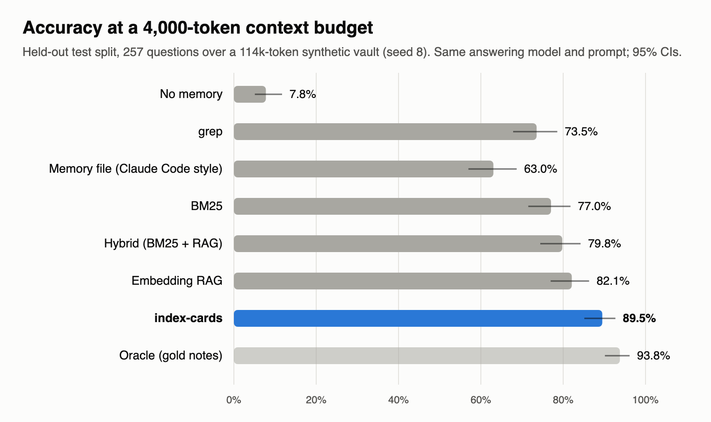
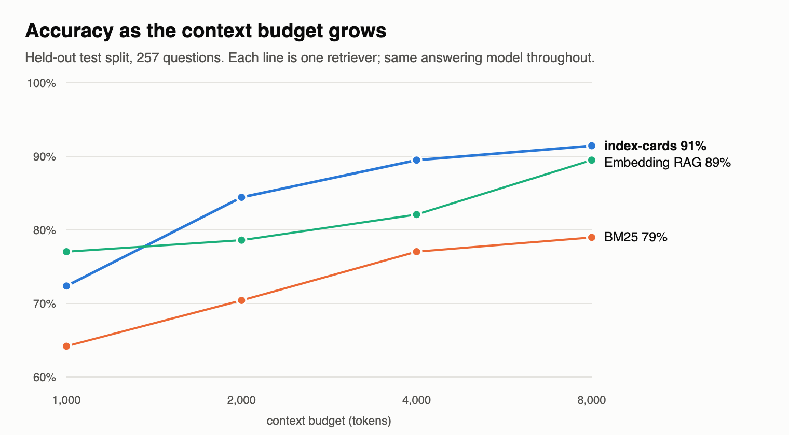

# index-cards

A deterministic memory layer for coding agents over a plain markdown vault, and a benchmark that measures it.



Code keeps one markdown **card** per person and project, listing every note that mentions it, with dates, newest
first. No model is called to build it. Asked a question, the agent reads the cards the question names, then the
notes they point to.

On 257 held-out questions about a fictional six-month vault (114k tokens), generated after the retriever was
frozen, with the same model, prompt and 4,000-token budget for every system, cards answer **89.5%**. Embedding
retrieval gets 82.1% (paired bootstrap p = 0.003), grep 73.5%, and a Claude Code style memory file 63.0%. The gap
comes from questions that need two notes, like "which city does the current owner of Kelp-DB live in?": cards get
70% of these and embedding retrieval 31%. The lead holds from 2,000 to 4,000 tokens. At 1,000 tokens embedding
retrieval is ahead, and at 8,000 the two converge.

One result goes the other way, and it matters. A Sonnet agent that can grep the vault itself in as many turns as it
likes gets 98% with or without cards, and uses fewer tokens without them. Cards pay off when the context is a
fixed budget, as in a hook, a prompt prefix, a small model or a single retrieval call. On a clean vault this size,
a strong agent with grep doesn't need them.

## Try it

```sh
pipx install git+https://github.com/abhaymettu/index-cards     # or: uv tool install git+https://...
index-cards demo
```

`demo` copies a bundled fictional vault (36 people, 12 projects, six months of daily notes) into
`./index-cards-demo`, builds its cards in about 0.1 s and prints one card and the context it builds for a question:

```
2026-11-01T05:42:27 entities=36 cards=36 changed=36 kept_gone=0 sources=197 unsourced=0 catalog_changed=True 0.1s

Context for "What is the current deadline for Kestrel-Sync?" (budget 600 tokens):

[index-cards/project/kestrel-sync.md] Kestrel-Sync (project), 11 entries, newest first
- 2026-08-04 13:30 · 00-Inbox/Daily/2026-08-04 · Kestrel-Sync status
- 2026-05-19 · 01-Projects/Kestrel-Sync · Kestrel-Sync (defining note)
...
[00-Inbox/Daily/2026-07-07.md | 2026-07-07]
**09:15 Deadline shift**
Kestrel-Sync is no longer due July 1, pushed out to July 18. Breathing room, but don't let it turn into slack.
```

On your own vault:

```sh
index-cards init ~/Documents/Vault      # writes ~/.config/index-cards/config.json; check the folder lists
index-cards sweep                       # builds <vault>/index-cards/
index-cards context "who owns the billing rewrite now?" --budget 4000
```

Then tell your agent where the cards are. One sentence in `CLAUDE.md` or `AGENTS.md` is enough: "Index cards:
`<vault>/index-cards/` holds one card per person and project (list in `_catalog.md`). Look for a card on the
question's subject first, then read the sources it lists." Python 3.9+, no dependencies.

## Results

Seed 8, the world generated after the retriever was frozen: test split, 257 questions, Claude Sonnet answering,
4,000-token budget. Scored by code. The first world (seed 7) gives the same order: cards 90.7%, RAG 84.0%.

| system | accuracy | single | multihop | update | aggregate | temporal | abstain errors | stale errors |
|---|---|---|---|---|---|---|---|---|
| no memory | 7.8% | 0% | 0% | 0% | 0% | 0% | 100.0% | 0.0% |
| grep | 73.5% | 94% | 3% | 99% | 84% | 100% | 26.6% | 0.0% |
| memory file (Claude Code style) | 63.0% | 47% | 69% | 71% | 24% | 63% | 29.5% | 2.3% |
| BM25 | 77.0% | 100% | 10% | 99% | 92% | 100% | 23.2% | 1.1% |
| hybrid (BM25 + RAG, RRF) | 79.8% | 100% | 16% | 100% | 96% | 100% | 21.5% | 0.0% |
| embedding RAG (nomic-embed-text) | 82.1% | 98% | 31% | 100% | 88% | 100% | 17.7% | 1.1% |
| **index-cards** | **89.5%** | 98% | **70%** | 94% | 92% | 100% | 9.3% | 1.1% |
| oracle (the gold notes) | 93.8% | 98% | 80% | 100% | 88% | 100% | 5.1% | 0.0% |

Abstain errors are answers of "unknown" to answerable questions. Stale errors are answers that give a superseded
value, out of the questions whose answer changed. 95% intervals and per-question bootstrap tests are in
`bench/runs/seed8/results/test.json`.



What the numbers say:

- **Two-hop questions decide it.** A question that names a project but asks about its owner gives similarity search
  nothing to match the owner's notes on. The project's card names the owner in its newest entries. One hop then
  reaches the owner's card, whose oldest entry is the note where you met them.
- **Stale facts were not the problem I expected.** When every chunk carries its date and the prompt says to trust the
  newest, every retriever gets the current value whenever the update is in context. At this budget it almost always
  is. Failures are mostly "unknown": the needed note was not retrieved.
- **The memory file keeps what it chose to keep.** It wrote each owner next to their city, so it does well on
  multihop (69%), but it drops collaborators (24% on aggregates) and dates (63% on temporal). On seed 8 it also grew
  past its cap and was cut, the way Claude Code cuts an over-long `MEMORY.md`.
- **The budget matters.** At 1,000 tokens a card's header, Timeline and defining note crowd out the rest, and
  embedding retrieval wins (77.0% against 72.4%). At 8,000 tokens similarity search holds both notes of a two-hop
  question, and the gap closes (91.4% against 89.5%, not significant).
- **Cards lose where no card exists.** Thirty of the 90 people have no note, so no card, and the retriever falls back
  to BM25. On questions about those people cards get 86% and embedding retrieval 95%. On people with a card the two
  tie at 93.5%.
- **With Haiku answering**, cards score 80.5% and embedding retrieval 77.0% (p = 0.15, not significant).

### The agent loop

Sonnet, given Read, Grep and Glob inside the seed-7 vault and no budget (`bench/agent.py`, 91 test questions):

| setup | accuracy | input tokens per question | turns | seconds |
|---|---|---|---|---|
| vault only | 98.9% | 20,860 | 3.9 | 10.1 |
| vault + memory file in the system prompt | 98.9% | 54,544 | 4.2 | 9.6 |
| vault + index-cards + one-line pointer | 97.8% | 26,211 | 5.4 | 11.5 |

With unlimited turns on a clean vault of this size, Sonnet greps its way to the answer and the cards are overhead.
Haiku did worse with them: 89.0% against 97.8% for the bare vault, at 45k tokens against 25k. Most of its extra
misses answered "where did I first meet X?" with a date.

### Reproduce

Cached answers are committed, so the tables rescore without a single model call:

```sh
BENCH_ROOT=bench/runs/seed8 python3 bench/score.py --split test         # the table above
BENCH_ROOT=bench/runs/seed8 python3 bench/score.py --split test --model haiku
BENCH_ROOT=bench/runs/main python3 bench/score.py --agent               # the agent loop
```

Rerunning from scratch needs the Claude Code CLI and `ollama pull nomic-embed-text`; see
[bench/README.md](bench/README.md). An easy setting (`bench/runs/small`, 36 people, 55k tokens) is included. There,
every dated retriever got all update questions right.

## How it works

```
vault/
  People/Ann Lee.md                 your notes, never written to
  01-Projects/Alpha-Engine.md
  00-Inbox/Daily/2026-10-01.md      **09:15 Title** blocks, one Timeline entry each
  index-cards/
    _catalog.md                     every card, entry count, last seen
    _registry.md                    things with no note; nicknames
    person/ann-lee.md               one card per entity
    project/alpha-engine.md
```

A card's Timeline, between markers the indexer owns, is rebuilt from the notes on every sweep. Each line has a
date, a link to the source block, an excerpt and a stable key. Everything outside the markers is yours and your
agents', and is never rewritten:

```markdown
## Timeline

<!-- index:start -->
- 2026-07-07 09:15 · [[00-Inbox/Daily/2026-07-07|2026-07-07]] · Deadline shift: Kestrel-Sync is no longer due July 1, pushed out to July 18. <!--k:5b2b02fdf8-->
- 2026-05-19 · [[01-Projects/Kestrel-Sync|Kestrel-Sync]] · Kestrel-Sync (defining note) <!--k:15c4572a57-->
<!-- index:end -->
```

`index-cards context` builds an agent's context from the cards named in the question: Timeline lines, then the
source blocks in reading order (the defining note, then newest and oldest alternating), then up to three cards one
hop away. A question that names no card falls back to BM25. It stops at the budget.

| layer | command | what it does | model calls |
|---|---|---|---|
| index cards | `index-cards sweep` | one card per entity; idempotent; same inputs give byte-identical cards | none |
| context | `index-cards context` | the retriever measured above | none |
| eval | `index-cards eval` | freeze your own question set, score any retriever on it (hit@k, MRR, answers) | none |
| nightly | `index-cards nightly` | duplicate, contradiction, stale-bullet and broken-link passes produce a patch; `--apply` keeps it only if your eval does not drop | none |
| digests | `index-cards digest` | compacts session transcripts into records the cards can cite | none |
| summaries | `index-cards consolidate` | optional: one model call per changed card writes a Summary whose every line cites a Timeline key; code rejects uncited lines | one per changed card |

`docs/CONSTITUTION.md` has the design rules the code enforces, and `docs/VAULT-LAYOUT.md` the layout and bullet
format.

## What is new here

LongMemEval and MELT benchmark long-term memory on chat histories. The MoM paper counts answers that repeat a
superseded value, and AMB tests memory layers inside coding tasks. I found no benchmark that puts grep, BM25,
embeddings, hybrid retrieval, an agent-written memory file and a deterministic entity index on the same markdown
corpus at the same token budget, with the superseded values recorded so stale answers are counted.

## Limits

- The vault is synthetic, and a model wrote its prose from fact templates, so it is cleaner than real notes. Every
  entity has a distinct name, and no one is referred to only by "she" or "my manager".
- I built index-cards and also designed the benchmark. Categories are reported separately so you can weight them.
  Every retriever change made after seeing results is logged in `RUNLOG.md`. The last two came after the seed-7 test
  run, which is why seed 8 exists and gives the headline. The retriever frozen before any test run (v1) scores 88.3%
  on seed 8.
- Status mentions keep coming for a few projects after they were marked cancelled or paused. That makes a handful of
  status questions ambiguous, for every system alike.
- The memory baseline simulates Claude Code's auto memory under the same budget. It is not the product itself.
- Two answering models (Sonnet, Haiku), two worlds, one agent-loop vault.
- Cards exist only for entities with a note or a registry line.

## Citation

Mettu, A. (2026). Index cards: a deterministic entity index as memory for coding agents, measured against grep,
retrieval and agent-written memory. https://github.com/abhaymettu/index-cards. Paper: `paper/index-cards.pdf`.

## License

MIT, see `LICENSE`.
